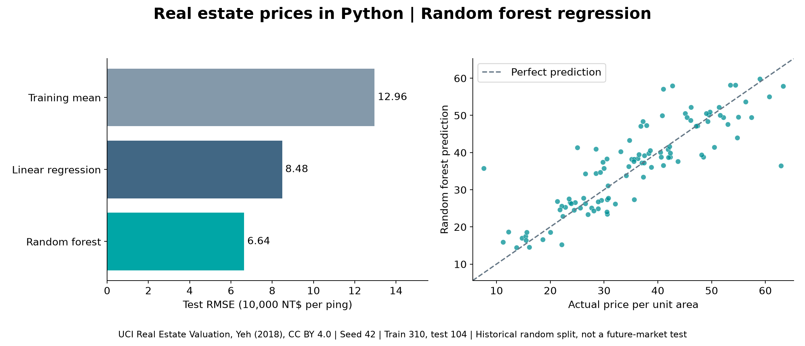

# Random forest regression for real estate prices in Python

A new Python portfolio analysis by James Ooko, prepared with AI assistance. It applies the workflow in the linked GeeksforGeeks tutorial to a local, attributed public-data snapshot rather than copying the salary example. This is separate from the earlier R analysis and is not a completed DA 621 submission.

## Question and data

Can a random forest predict price per unit area more accurately than a linear baseline using house age, distance to the nearest MRT station, and nearby convenience stores?

The local `data.csv` contains 414 historical UCI Real Estate Valuation records. Columns are shortened; values are preserved. Price is measured in 10,000 New Taiwan dollars per ping. Record ID is excluded from prediction; date, latitude, and longitude are also excluded to retain the earlier three-predictor question. Numeric predictors need no categorical encoding.

Source: Yeh, I. (2018). Real Estate Valuation. UCI Machine Learning Repository. https://doi.org/10.24432/C5J30W
Dataset: https://archive.ics.uci.edu/dataset/477/real+estate+valuation+data+set
Data license: CC BY 4.0. Attribution applies to the redistributed snapshot.

## Run

Use Python 3.12. Create a virtual environment, then:

```sh
pip install -r requirements.txt
python analysis.py
```

The script resolves files relative to itself. It writes metrics, row-level predictions, split membership, all candidate cross-validation scores, and the plotted evaluation.

## Method

Checks confirm 414 rows, unique record IDs, and finite selected numeric values. A 75/25 random split with seed 42 yields 310 training and 104 test rows. The saved split makes membership inspectable. Five-fold shuffled cross-validation with seed 42 on training data selects forest depth, minimum leaf size, and feature fraction from 18 combinations. Each forest has 300 trees and bootstrap sampling. Selection uses mean validation RMSE; the test set is used only after parameter selection. No feature scaling is necessary for this forest.

Selected parameters: max_depth=10, min_samples_leaf=1, max_features=1.0. Thus the selected forest considers all three features at each split; bootstrap samples still vary between trees. Mean training-fold validation RMSE: 7.6775.

## Held-out results

| Model | RMSE | MAE | R-squared |
|---|---:|---:|---:|
| Training-mean baseline | 12.9621 | 10.7039 | -0.0593 |
| Linear regression | 8.4836 | 6.2122 | 0.5463 |
| Random forest | 6.6397 | 4.6436 | 0.7221 |

Random forest has approximately 21.7% lower RMSE than linear regression on these same 104 test rows. RMSE and MAE are in the target's original units. R-squared is not a percentage accuracy score.



## Interpretation and limits

The forest improves on both baselines on this split. The prediction plot also shows underprediction for the largest observed prices. A lower aggregate error does not mean every prediction improved.

This is a small historical dataset and a random row split, not a future-market test or external validation. Similar properties can occur in both sets. There is no causal claim, uncertainty interval, inflation adjustment, or deployment claim. The earlier R results used a different split and must not be compared as if they were this experiment. Further evaluation should predefine repeated or temporal validation before making broader conclusions.

## References

Tutorial inspiration: https://www.geeksforgeeks.org/machine-learning/random-forest-regression-in-python/
Official estimator documentation: https://scikit-learn.org/stable/modules/generated/sklearn.ensemble.RandomForestRegressor.html

Code is an original adaptation; the tutorial's prose and graphics are not redistributed. See metrics.json for runtime version and input checksum.
